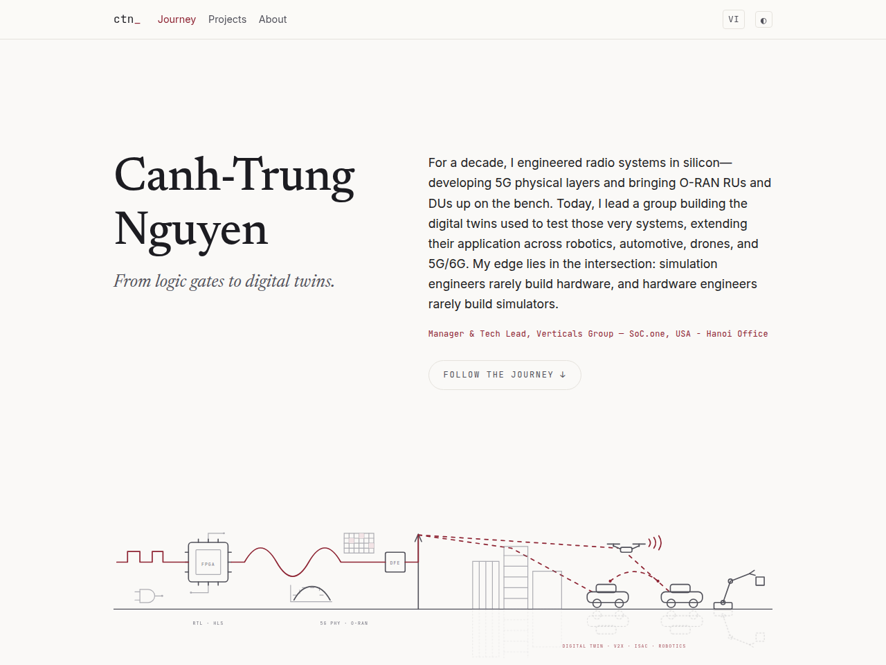

<div align="center">

# Canh-Trung Nguyen — Portfolio

**From logic gates to digital twins.**

_My engineering journey, professional work, and personal projects._

[](https://github.com/nguyencanhtrung/portfolio/actions/workflows/deploy.yml)

[Website](https://bibo.id.vn/) · [Quickstart](#quickstart) · [Features](#features) · [Docs](#documentation)



</div>

## Overview

A personal portfolio built with Astro 5. It covers FPGA design, radio systems,
digital twins, and robotics. English lives at `/`. Vietnamese lives at `/vi/`.
The site runs as static pages on GitHub Pages.

## Features

- **Career journey.** Five chapters, from digital logic to simulation systems.
- **Project catalog.** Separate sections for professional and personal projects.
- **Two languages.** English and Vietnamese pages with a language switch.
- **Responsive design.** Light and dark themes, SVG schematics, and motion controls.

Blog pages and RSS are archived. Their content and images remain in the repository.

## Prerequisites

- Node.js 24 with npm.
- Git.

## Quickstart

```sh
git clone https://github.com/nguyencanhtrung/portfolio.git
cd portfolio
npm ci
npm run dev
```

Open `http://localhost:4321`. Changes reload automatically.

To preview the production build, stop the dev server and run:

```sh
npm run build
npm run preview
```

Open the same address. The build writes static pages and a Pagefind index to `dist/`.
Rebuild after edits to refresh the preview. Run `npm test` for the unit tests.

## Documentation

| Topic | Reference |
| --- | --- |
| Visual system | [Design guide](DESIGN.md) |
| Career content | [Journey data](src/data/journey.ts) |
| Projects and case studies | [Catalog](src/data/projectCatalog.ts) · [Project details](src/data/projects.ts) |
| Interface text | [Translations](src/i18n/ui.ts) |
| Colors, fonts, and layout | [Global styles](src/styles/global.css) |
| Deployment | [GitHub Pages workflow](.github/workflows/deploy.yml) |

Update both languages when changing content. Keep technical terms in English in
Vietnamese copy. Use public project descriptions. Leave customer names, internal
codenames, and confidential metrics out of the site.

Pushes to `main` trigger the deployment workflow. It builds and publishes the site
at [bibo.id.vn](https://bibo.id.vn/).

## License

This repository has no project license file. Contact the owner for reuse permission.
Third-party dependencies and fonts retain their own licenses.
